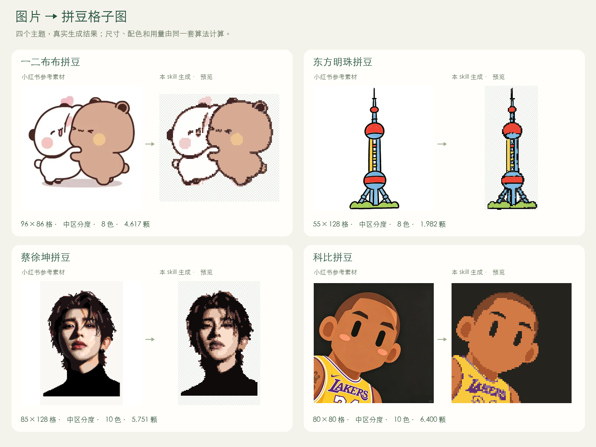
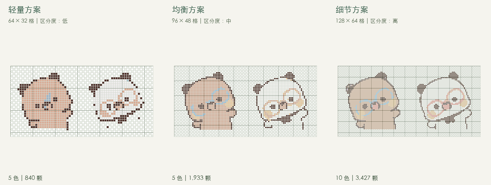
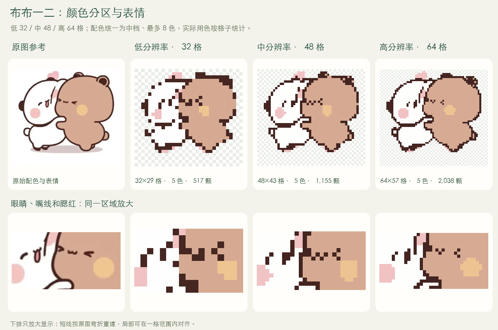
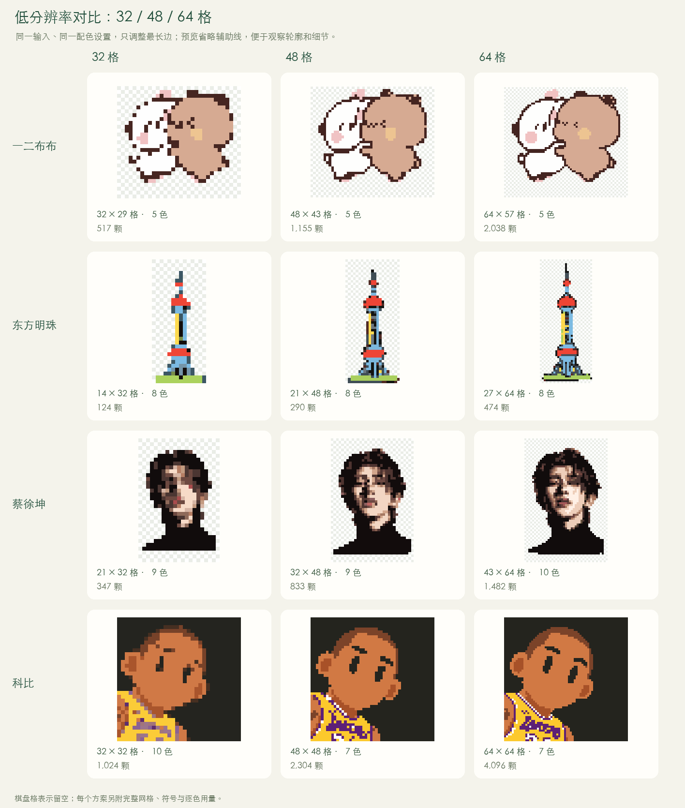

# 小格工坊 · craft-pattern

**给 Agent 一张图片，直接拿到拼豆格子图。**

可以指定横纵格数、控制颜色区分度，也可以一次生成几种方案，比较效果、用色和制作量后再选。每张图都有逐色用量、符号制作图和可编辑文件；需要自己改图时，再打开编辑器。

[快速使用](#快速使用) · [多方案对比](#同一张图给你几种选择) · [低分辨率结果](#四张图的低分辨率结果) · [下载示例](#四个主题实际生成) · [参数说明](#哪些可以自己指定) · [Skill 工作流](SKILL.md)



左侧素材选自小红书，右侧由本 skill 实际转换。首屏使用无辅助线预览方便看清形状，完整网格与符号制作图可在下方打开。[笔记来源、作者及处理说明](examples/showcase/SOURCES.md)。

## 这个 skill 能做什么

| 你想要的结果 | skill 会交付什么 |
| --- | --- |
| **直接出图** | 上传照片、插画或像素参考，用自然语言提要求，Agent 直接在聊天里展示 PNG 格子图 |
| **几种方案一起看** | 按不同尺寸、低/中/高颜色区分度生成对比图，列出实际色数与用豆数 |
| **知道要准备多少豆子** | 按实际格子统计各色所需颗数，透明空位不计材料，支持下载 CSV |
| **拿去照着制作** | 带坐标、符号、色号和用量的 PNG 图纸，以及可缩放 SVG |
| **继续调整** | 保留可编辑 JSON；页面支持上传、调格数、统一换色、区域高亮、画笔、留空橡皮和撤销 |
| **下次还能找回来** | 自动存入本地案例库，按名称、标签、尺寸、色数和用豆数检索，保留版本与源图 |
| **带字图片图文分区** | Agent 默认检查文字与图案，分别处理；已确认的英文/数字可独立排成点阵字。原字形清楚时保留，不支持的字符说明限制。当前脚本需文字区配置，非自动 OCR 或品牌字体还原 |

## 快速使用

### 1. 安装 skill

准备 **Python 3.9+**、**Node.js 18+**，安装到 Codex 的技能目录：

```sh
git clone https://github.com/Falix23/craft-pattern-skill.git ~/.codex/skills/craft-pattern
cd ~/.codex/skills/craft-pattern
python3 -m venv .venv
. .venv/bin/activate
python -m pip install -r requirements.txt
```

Node.js 用于直接出图；图片转换在本机完成，无需额外图像模型 API 或 API Key。使用页面编辑器本身无需 Node.js。Agent 可使用上述虚拟环境中的 Python 执行脚本。

### 2. 给 Agent 图片，再说你想怎么拼

直接出一张：

```text
使用 $craft-pattern，把这张一二布布做成 64 格宽的拼豆图，
背景留空、配色简洁，直接返回格子图、符号制作图和各色用量。
```

一次给几种选择：

```text
使用 $craft-pattern，用同一张图片做三种方案：
48 格低区分度、64 格中区分度、96 格高区分度。
展示对比图，列出每种方案的色数和用豆数，帮我推荐一个。
```

固定尺寸，只比较配色：

```text
都做成 64×64 格，分别用低、中、高三档颜色区分度。
主体完整保留，直接给我三张图和用量，不用打开编辑页面。
```

只要求一张就生成一张；已指定尺寸时按要求生成。未指定参数时，单图从最长边 64 格、中区分度、最多 8 色开始，Agent 会查看实际结果再交付。

## 同一张图，给你几种选择

下面三种方案使用**同一张布布一二输入图**，同时调整尺寸与颜色区分度，展示制作量的取舍：



| 方案 | 格数 | 颜色区分度 | 实际用色 | 用豆数 | 符号制作图 |
| --- | --- | --- | --- | --- | --- |
| 轻量 | 64×57 | 低 | 5 色 | 2,038 颗 | [查看](assets/showcase/bubu-01-chart.png) |
| 均衡 | 96×86 | 中 | 5 色 | 4,617 颗 | [查看](assets/showcase/bubu-02-chart.png) |
| 细节 | 128×115 | 高 | 7 色 | 8,239 颗 | [查看](assets/showcase/bubu-03-chart.png) |

这组图使用完整的双人拥抱原图，可从 **96×86 中档**开始；脸部表情和外轮廓清楚，5 色分别表现描边、白色、毛色、粉色腮红和黄色腮红。低格数更省豆子，高档保留更多轮廓和配色层次。颜色数是上限，不会为了凑满数量保留近似色；不同档位也可能得到相同色数。

## 四个主题，实际生成

| 案例 | 本次设置 | 实际用色 / 用豆 | 完整制作图 | 材料与可编辑文件 |
| --- | --- | --- | --- | --- |
| 一二布布拼豆 | 96×86 · 中区分度 · 去底 | 5 色 / 4,617 颗 | [PNG](assets/showcase/bubu-02-chart.png) | [CSV](examples/showcase/patterns/bubu-02.csv) · [JSON](examples/showcase/patterns/bubu-02.json) |
| 东方明珠拼豆 | 55×128 · 中区分度 · 彩色线稿、去底 | 8 色 / 1,982 颗 | [PNG](assets/showcase/tower-01-chart.png) | [CSV](examples/showcase/patterns/tower-01.csv) · [JSON](examples/showcase/patterns/tower-01.json) |
| 蔡徐坤拼豆 | 85×128 · 中区分度 · 去底 | 10 色 / 5,751 颗 | [PNG](assets/showcase/caixukun-01-chart.png) | [CSV](examples/showcase/patterns/caixukun-01.csv) · [JSON](examples/showcase/patterns/caixukun-01.json) |
| 科比拼豆 | 80×80 · 中区分度 · 保留背景 | 8 色 / 6,400 颗 | [PNG](assets/showcase/kobe-01-chart.png) | [CSV](examples/showcase/patterns/kobe-01.csv) · [JSON](examples/showcase/patterns/kobe-01.json) |

输入类型各有不同：布布一二使用单张完整拥抱插画；东方明珠选取彩色线稿中的单体塔身；科比使用插画；蔡徐坤使用原帖已有像素预览，展示重新采样与简化配色。原设计归原作者，右侧格子、符号及材料统计由本项目重新生成。所有统计均可对照[生成记录](examples/showcase/summary.json)与图纸 JSON。

## 清晰分区与表情：32 / 48 / 64 格

同一张布布一二原图，固定中档配色、最多 8 色，只改变最长边。三档实际均使用 **5 色**：描边、白色、毛色、粉色、黄色。先识别原图中的稳定纯色区域，再缩成格子，避免轮廓边缘的混色额外占用材料。



短线按原图的中心线走向和弯折重建；在格子允许时保留转角与笔画间隔，局部可在一格范围内对齐，不手工逐格修图。封闭舌头、腮红等彩色区域不按暗线改画。32 格保留概括的眯眼和嘴线，48 格适合平衡表情与制作量，64 格轮廓更细；低格数下短线仍有像素化变形。

[32×29 格 · 517 颗制作图](assets/showcase/low-resolution/bubu-32-chart.png) · [48×43 格 · 1,155 颗制作图](assets/showcase/low-resolution/bubu-48-chart.png) · [64×57 格 · 2,038 颗制作图](assets/showcase/low-resolution/bubu-64-chart.png)

## 四张图的低分辨率结果

同样的四张输入，分别按**最长边 32、48、64 格**等比生成。每一行都保持原有背景处理、清理方式、中档颜色区分度和颜色上限，只改变格数，便于判断分辨率本身的影响。



下表每项为“实际横×纵格数 / 实际色数 / 用豆数”，点击可打开带符号、坐标与材料统计的完整制作图。

| 主题 | 最长边 32 格 | 最长边 48 格 | 最长边 64 格 |
| --- | --- | --- | --- |
| 一二布布 | [32×29 / 5 色 / 517 颗](assets/showcase/low-resolution/bubu-32-chart.png) | [48×43 / 5 色 / 1,155 颗](assets/showcase/low-resolution/bubu-48-chart.png) | [64×57 / 5 色 / 2,038 颗](assets/showcase/low-resolution/bubu-64-chart.png) |
| 东方明珠 | [14×32 / 8 色 / 124 颗](assets/showcase/low-resolution/tower-32-chart.png) | [21×48 / 8 色 / 290 颗](assets/showcase/low-resolution/tower-48-chart.png) | [27×64 / 8 色 / 474 颗](assets/showcase/low-resolution/tower-64-chart.png) |
| 蔡徐坤 | [21×32 / 9 色 / 347 颗](assets/showcase/low-resolution/caixukun-32-chart.png) | [32×48 / 9 色 / 833 颗](assets/showcase/low-resolution/caixukun-48-chart.png) | [43×64 / 10 色 / 1,482 颗](assets/showcase/low-resolution/caixukun-64-chart.png) |
| 科比 | [32×32 / 10 色 / 1,024 颗](assets/showcase/low-resolution/kobe-32-chart.png) | [48×48 / 7 色 / 2,304 颗](assets/showcase/low-resolution/kobe-48-chart.png) | [64×64 / 7 色 / 4,096 颗](assets/showcase/low-resolution/kobe-64-chart.png) |

低格数同时检查形状和明显不同的配色：布布一二先按纯色区域采样，再按短线弯折保留表情，左右腮红分别为粉色、黄色；东方明珠仍保留三处红色球体和蓝色塔身。复杂图像沿用局部黑帽与结构张量辅助采样。所有规则均为传统图像处理实现，无深度学习模型或新增运行依赖。小字、复杂人像五官仍需逐图检查。

这里的低分辨率不等于“低颜色区分度”。例如布布一二的 64 格结果在本节使用中档配色，与上面的“64 格低区分度”方案参数不同。重采样会改变颜色分组，实际色数可能上下波动；用豆数、空位和材料清单均按本次真实格子重新计算。

完整低分辨率记录与各方案 JSON / SVG / CSV 见[生成记录](examples/showcase/low-resolution-summary.json)和[图纸目录](examples/showcase/low-resolution/)。

使用 skill 时，Agent 默认对所有带字图片先做图文分区检查；需要重排且内容已确认时，用 `--lettering lettering.json` 在图案采样之后排字。点阵字的形状、大小或换行会与原图不同，原文字区之外的格子与色板保持不变。当前重排器支持大写英文、数字及少量标点；中文、特殊字体等仍需保留原字形核查，不能保证自动重排。配置、示例及网页编辑边界见[文字分区说明](references/lettering.md)。

每个方案的文件各有用途：

| 文件 | 用途 |
| --- | --- |
| `preview.png` | 带辅助网格的配色预览，快速检查形状 |
| `pattern.png` | 带坐标、逐格符号、色号和用量的制作图，点开可放大 |
| `pattern.svg` | 可缩放、可打印的符号图纸 |
| `materials.csv` | 各色所需颗数，方便备料 |
| `pattern.json` | 完整格子数据与处理参数，可继续编辑 |
| `comparison.png` | 多方案并排对比；只生成单图时不产生 |

## 哪些可以自己指定

| 选项 | 怎么说 / 有什么作用 |
| --- | --- |
| 图纸格数 | “宽 48 格”或“最长边 96 格”按原图比例计算另一边；“64×80 格”使用指定画布。横纵各支持 4–160 格 |
| 图片适配 | 完整保留并留边，或居中裁切铺满；默认等比适配，不拉伸主体 |
| 颜色区分度 | **低**优先合并近色、少用材料；**中**平衡用色与层次；**高**保留更多细微色差 |
| 最多颜色 | 自动提取 2–36 色，默认最多 8 色；也可以提供自己的色板，保留自定义色号 |
| 背景 | 保留透明、去除外围纯色背景，或把背景一起拼出。棋盘格表示不放豆子 |
| 碎色整理 | 默认“拼豆优先”，将小范围近色碎块并入邻近区域；需要时保留更多原图细节 |
| 交付数量 | 一张、三张或自定义方案组合；同一张输入可比较尺寸，也可固定尺寸比较配色 |

“64×64”是 4,096 个**画布格位**，用豆数还要减去空位。实际成品大小取决于豆子间距；自动 RGB 配色不是品牌官方色号，背景复杂或五官细小时仍需检查。

## 不通过 Agent，也能直接运行

在仓库目录、已激活上述 Python 环境时：

```sh
# 直接出图：指定宽度，按比例计算高度
python scripts/generate.py examples/showcase/inputs/bubu.webp --width 64 --background auto

# 一次比较 48/低、64/中、96/高三种起始方案
python scripts/generate.py examples/showcase/inputs/bubu.webp --compare --background auto

# 固定画布、颜色区分度和颜色上限
python scripts/generate.py /绝对路径/photo.png --width 64 --height 80 --color-detail low --max-colors 6
```

默认输出到 `~/.craft-pattern/outputs/` 下的新目录，stdout 和 `manifest.json` 给出各文件的绝对路径、格数、实际色数与用豆数；默认自动归档。`--plans` 可自定义方案组合，`--palette` 使用指定色板，`--output` 指定新的输出目录。完整说明见[直接出图协议](references/direct-output.md)。

## 需要自己编辑时

```sh
python scripts/serve.py --background
```

打开 [本地编辑器](http://127.0.0.1:8765/docs/index.html)，选择或拖入图片，调整格数、背景、配色和清理强度后生成。点击材料色号可圈出同色区域；“调色”统一替换该颜色，也能逐格绘制、擦除、撤销，最后导出 SVG / CSV / JSON 或打印。

案例库默认在 `~/.craft-pattern/library`，与仓库分开。生成会自动保存，手工修改可存为新版本。Agent 可检索已有作品，例如：

```sh
python scripts/library.py search "布布" --max-colors 8 --max-beads 2000
```

`--library` 或 `CRAFT_PATTERN_LIBRARY` 可指定其他库。直接打开单文件 HTML 时使用独立的浏览器 IndexedDB，迁移用整库备份。服务管理、版本与备份见[案例库协议](references/library.md)。图片转换及归档均在本地完成。

## 开发与验证

```sh
python -m pip install -r requirements-dev.txt
python scripts/check.py

# 重建 README 的四组展示图；读取已选本地素材，不写用户案例库
python scripts/build_showcase.py

# 更新内置编辑器示例；修改模板或脚本后运行
python scripts/build_demo.py
```

`assets/` 保存模板、样式与浏览器模块；`scripts/` 提供生成、渲染、案例库与服务；`tests/` 覆盖回归；`references/` 保存协议。`docs/index.html` 与 `docs/index.json` 是生成文件；统一检查会验证源码与示例同步。开发检查使用临时目录，运行依赖与开发工具分开维护。

[Skill 工作流](SKILL.md) · [直接出图协议](references/direct-output.md) · [图纸与参数协议](references/schema.md) · [案例库协议](references/library.md)

## 素材与许可

项目代码采用 [MIT](LICENSE)。本页四个小红书示例的原始插画、像素设计、照片和相关角色权利不包含在代码许可中，详见[来源、署名与处理记录](examples/showcase/SOURCES.md)。`examples/demo.png` 与 `examples/cases/` 仍保留为本项目原创合成回归样例。普通用户的照片、图纸和案例库保存在用户目录，不随项目提交。
