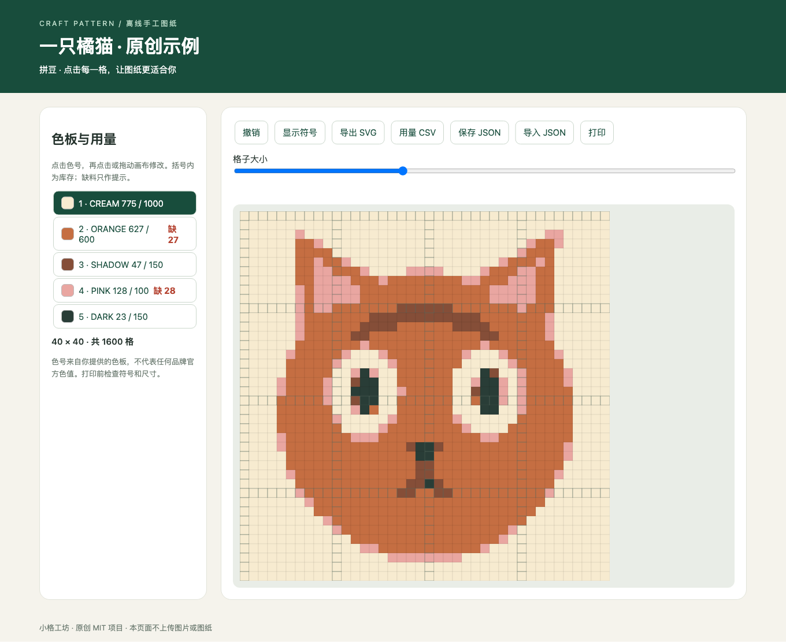

# 小格工坊 · craft-pattern

[在线合成示例](https://Falix23.github.io/craft-pattern-skill/) · [Skill 工作流](SKILL.md)

把照片转换为可编辑的拼豆／十字绣格子图。原创的离线 Agent Skill：Pillow 负责缩放和指定色板映射，Agent 负责理解用户图片与制作要求，页面负责逐格修改与导出。



## 运行

```sh
python3 -m venv .venv
. .venv/bin/activate
pip install -r requirements.txt
python scripts/build.py examples/input.json --output outputs/demo.html
python -m unittest discover -s tests -v
```

用浏览器打开 `outputs/demo.html`。点击色板，再拖动画布修改；支持撤销、符号、用量统计、缺料提示、SVG、材料 CSV、JSON 导入导出和打印。构建同时输出初始 `demo.json`，页面的修改要另点“保存 JSON”。所有页面功能离线执行，不上传图片。

## 安装为 Skill

将本仓库克隆到 `~/.codex/skills/craft-pattern`；也可把本目录复制到对应位置。依赖安装在运行该 skill 的 Python 环境中。发图并说：“使用 $craft-pattern，把这张图做成 40 格宽、最多这 5 色的拼豆图纸。”详见 [SKILL.md](SKILL.md) 与 [数据协议](references/schema.md)。

## 首版范围

提供基于 RGB 色板的确定性近似，不自动识别品牌色号，不做语义级轮廓重绘。库存用于报告缺料；不会为了库存而自动改坏图案。`cross-stitch` 与 `bead` 使用同一种格子数据，不生成自由刺绣针法。SVG 每格 5 mm 仅是图纸比例，实物尺寸由材料决定；大图打印可能需要打印软件分块。

`examples/demo.png` 为本项目原创绘制的猫，配置、库存与色号均为合成演示。不要把真实用户照片放入公开仓库。依赖 Pillow 按其自身许可分发；本项目原创代码和示例采用 [MIT](LICENSE)。
